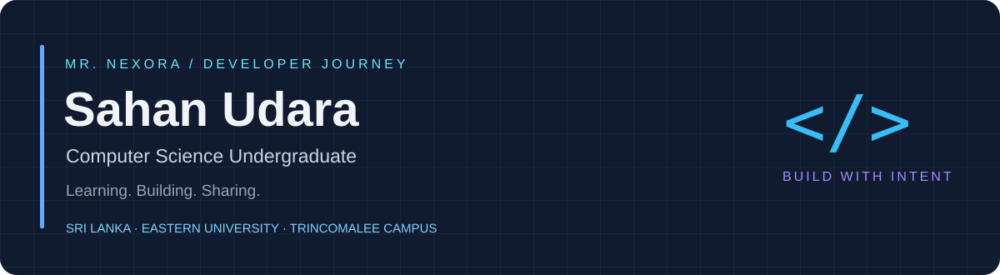
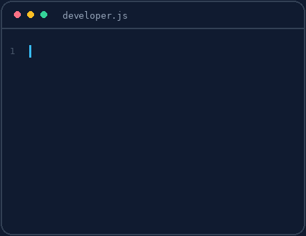
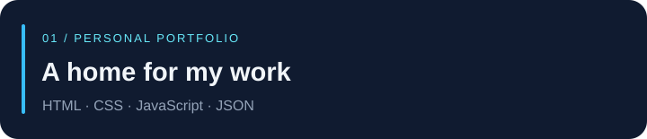
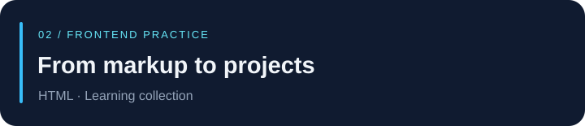
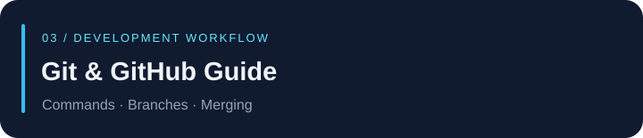

  

  
  
  
  
  

  
  
  

## About

I'm **Sahan Udara**, also known as **Mr. Nexora**, a Computer Science undergraduate at **Eastern University, Sri Lanka — Trincomalee Campus**.

I'm developing my skills through coursework, independent learning, and practical web projects. My foundation is in **HTML, CSS, and C++**, and I'm continuing to learn **JavaScript, Java, and MySQL**.

My direction is **full-stack development with a security mindset**. I also share learning resources through **Mr Nexora Academy** and develop digital projects under **SU Nexora**.

**Based in Sri Lanka · Open to student collaboration and constructive feedback.**

 

## Current work

| Focus | Status | Next milestone |
| :--- | :--- | :--- |
| Programming foundations | Learning | Turn JavaScript, Java, and SQL concepts into documented exercises |
| Mr Nexora Academy | In development | Organize learning resources and project walkthroughs |
| GitHub collections | Organizing | Improve repository navigation and project instructions |

<!-- Keep only active work here. Update milestones when they change; do not imply that planning is completed work. -->

## Projects

A web portfolio for my background, projects, and learning journey, with JSON-driven content.

**Practice areas:** Responsive interfaces, content organization, and presenting my work clearly.

  

A collection of HTML practice projects connecting individual lessons with practical page-building exercises.

**Practice areas:** Semantic markup, page structure, and clear examples.

  

A beginner-oriented reference for Git commands, commits, branching, and merging.

**Practice areas:** Documenting workflows and making development concepts easier to revisit.

<!-- Replace these entries as stronger work becomes available. State actual contributions and known limitations in each project README. -->

## Roadmaps

I organize my learning around lessons, exercises, and practical projects. These collections are at different stages of completion.

| Collection | Focus |
| :--- | :--- |
| [C++](https://github.com/mr-nexora/cpp-learning-portfolio) | Programming fundamentals and exercises |
| [HTML](https://github.com/mr-nexora/html-learning-portfolio) | Markup and page structure |
| [CSS](https://github.com/mr-nexora/css-learning-portfolio) | Styling and layout practice |
| [JavaScript](https://github.com/mr-nexora/js-learning-portfolio) | Language fundamentals and browser scripting |
| [Java](https://github.com/mr-nexora/java-learning-portfolio) | Coursework and programming practice |
| [MySQL](https://github.com/mr-nexora/mysql-learning-portfolio) | Database concepts and SQL practice |

<b>Longer-term learning direction</b>

1. Full-stack foundations
2. Software engineering and SaaS
3. DevOps and cloud
4. Cybersecurity

These later stages describe my learning plan, rather than current expertise.

<!-- Link the master index for the 17 roadmaps here after it is published. -->

## Toolkit

| Area | Technologies and tools |
| :--- | :--- |
| Foundations & practice | HTML · CSS · C++ |
| Currently learning | JavaScript · Java · MySQL |
| Development workflow | Git · GitHub · VS Code · Notepad++ |
| Design & recording | Figma · Canva · OBS Studio |

## Brands

**SU Nexora** is the umbrella for my independent digital projects. These are initiatives I am developing, with different levels of progress.

| Initiative | Focus |
| :--- | :--- |
| **Mr Nexora Academy** | Coding tutorials, project walkthroughs, and learning resources |
| **Kidzy Nexora** | Children's learning materials and activity books |
| **Wayora Travels** | Travel content and resources |

Other creative initiatives

- **Relax With Yumi** — relaxation and study music content.
- **English Pod Nook** — English-learning podcast content.

<!-- Add verified brand/channel links when available. Avoid placeholder URLs. -->

## Contact

Interested in a student project, a practical web collaboration, or exchanging feedback on learning resources?

**[Send me an email](mailto:mr.nexora.dev@gmail.com)** · **[Connect on LinkedIn](https://www.linkedin.com/in/mr-nexora/)** · **[Visit my portfolio](https://mr-nexora.github.io/mr-nexora-personal-portfolio/)**

Sahan Udara · Mr. Nexora · Learning. Building. Sharing.

